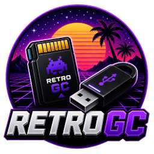
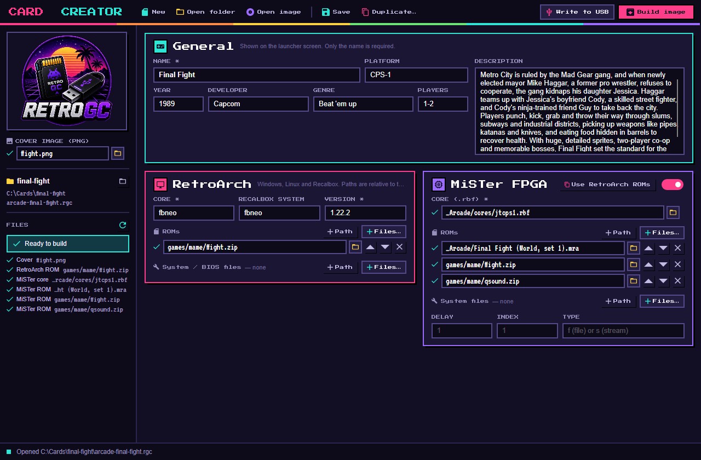

<div align="center">



# 🛠️ Retro Game Card: Creator

### Make [Retro Game Card](https://github.com/retrogc/retrogc-launcher) game cards, on Windows and Linux

[](https://dotnet.microsoft.com/)
[](https://avaloniaui.net/)
[](LICENSE)

<br />



</div>

---

A desktop app to create and edit game cards without writing JSON or using the command line:

- 📂 **Open a card folder**: every field is filled from its `.rgc` definition.
- 🆕 **Start a new card** in an empty folder.
- 📑 **Duplicate a card** (folder, `.rgc` or image) into a new empty folder, which becomes the new card's
  root, to make a new card from an existing one.
- 💽 **Open a card image** (`.img.xz` or `.img`): just view it (read-only), or extract it to a folder
  to edit and rebuild it. Write to USB works straight from a viewed image.
- ✏️ **Edit every field**: name, description, platform, year, developer, genre, players, cover,
  RetroArch core / Recalbox system / ROMs / BIOS files, and the optional MiSTer FPGA section.
- 🔎 **Fill it from [ScreenScraper](https://screenscraper.fr/)**: find the game by its ROM (checksums) or by
  name, pick the right result, the language and region (World by default), the picture (box, screenshot,
  logo…), and tick the fields to fill.
- 📥 **Add the files**: pick a ROM, BIOS, core or cover anywhere on your disk and it is copied into
  the card at the right place. Missing files are listed, one click fills them.
- 💿 **Build the image**: a `.img.xz` FAT32 image labelled `RETROGC` on a read-only GPT partition, the same as
  `retrogc-image.sh --build`, ready for balenaEtcher.
- 🔌 **Write to USB**: flash the card straight to a USB stick.

Fields the app doesn't know are kept when saving, so cards stay compatible with newer formats.

## 🖥️ Platforms

| | Platform | Build image | Open image | Write to USB |
|:-:|---|:-:|:-:|---|
| 🪟 | **Windows** x64 | ✅ | ✅ | ✅ asks for administrator rights (UAC) |
| 🐧 | **Linux** x64 | ✅ | ✅ | ✅ asks for your password (polkit / `pkexec`), needs `udisksctl` |

Images are built and read entirely by the app (its own FAT writer / reader and a bundled xz
library): no `mkfs`, `mtools` or other tools are needed, on either system.

## 🚀 Usage

1. Download `retrogc-creator` for your system from the
   [**releases page**](https://github.com/retrogc/retrogc-creator/releases) and run it
   (on Linux: `chmod +x retrogc-creator` first).
2. **Open folder** (a card folder with its `.rgc`), **Open image** (a card `.img.xz`, see below) or
   **New card** (an empty folder).
3. Fill in the fields. Use **Choose file…** / **Add files…** to bring the game files in: they are
   copied into the card (`games/<system>/` for ROMs and BIOS, `_Console/` or `_Arcade/` for MiSTer).
4. When the sidebar says **Ready to build**, press **Build image** (saves the card first), then
   **Write to USB**, or flash the `.img.xz` with [balenaEtcher](https://etcher.balena.io/).

### 🔎 Filling a card from ScreenScraper

[**ScreenScraper**](https://screenscraper.fr/) is a huge community database of retro games: names,
descriptions, release dates, developers, genres, box art, screenshots, logos… The creator can fill a card
from it in a few clicks:

1. Press **ScreenScraper…** in the General section.
2. The window identifies the card's first RetroArch ROM by its checksums (CRC32, MD5, SHA1), on the
   system matching the card's Recalbox system or platform. If the ROM is unknown, or the card has none yet,
   it searches the **name** instead (type another one and press **Search** if needed).
3. When several games match, pick the right one in the results.
4. Choose the **language** (description, genre) and the **region** (name, year, pictures). Region is
   **World** by default, then the other regions when ScreenScraper has nothing for World.
5. Choose the **picture**: **Mix (v2)** by default (screenshot, box and logo in one square picture: it fits
   the launcher's square cover frame exactly), or box (2D / 3D), screenshot, title screen, logo… It is saved as
   the card's PNG cover.
6. Everything ScreenScraper has is ticked: untick what you want to keep, edit values if needed, press **Fill the card**,
   then save the card.

| | |
|---|---|
| 👤 **Account** | Optional. A free [screenscraper.fr](https://screenscraper.fr/) account gives more requests per day: enter it under **ScreenScraper account** in the window. |
| ⚙️ **Settings** | Language, region, picture type and account are remembered in `%APPDATA%\retrogc-creator` (Windows) or `~/.config/retrogc-creator` (Linux). |
| 📊 **Quota** | The window shows how many requests you made today out of your daily limit. |

### 💽 Opening a card image

**Open image** reads any game card image (`.img.xz` or raw `.img`), whether it was made by the
creator, by [`retrogc-image.sh`](https://github.com/retrogc/retrogc-launcher/blob/main/Platforms/Linux/retrogc-image.sh)
or downloaded from a release. Then choose:

| Choice | What happens |
|---|---|
| 📂 **Extract to a folder…** | The card is unpacked into a new folder (named after the image) and opens like any card folder: edit it, add files, rebuild it. |
| 👀 **Just view** | The card is unpacked to a temporary folder and opens **read-only**. **Write to USB** flashes the image as is (no rebuild), and **Extract…** turns it into an editable copy. The temporary folder is deleted when you close the card. |

FAT12, FAT16 and FAT32 images are supported (GPT or no partition table). Installer cards
(exFAT) aren't game cards and can't be opened.

The `.rgc` format itself is documented in the
[launcher README](https://github.com/retrogc/retrogc-launcher#-the-rgc-card-format).

### ⌨️ Command line

```bash
retrogc-creator <card folder | card.rgc>                  # open a card
retrogc-creator --build <card folder> <output.img.xz>     # build an image without the window
retrogc-creator --extract <image.img.xz> <folder>         # unpack a card image without the window
```

## 🧑‍💻 Building from source

> Requires the [**.NET 10 SDK**](https://dotnet.microsoft.com/download).

```bash
git clone https://github.com/retrogc/retrogc-creator.git
cd retrogc-creator
dotnet run
```

```text
Src/
├── 📁 Models/        CardDocument: the .rgc as a JSON tree (keeps unknown fields)
├── 📁 Services/      Fat32ImageWriter / FatImageReader, ImageBuilder / ImageExtractor (xz),
│                     CardFolder, UsbDrives, Flasher, ScreenScraper/ (api2 client)
├── 📁 ViewModels/    MVVM view models (CommunityToolkit.Mvvm)
├── 📁 Views/         Main window, USB writer window, ScreenScraper window
└── 📁 Styles/        Theme shared with the launcher
```

Release builds are self-contained, trimmed, single-file executables, built by the
[**release workflow**](.github/workflows/release.yml).

## 🙏 Thanks

A big thank you to [**ScreenScraper**](https://screenscraper.fr/) and its community. For years they have
gathered, checked and shared the data and artwork of tens of thousands of retro games, and they keep the
API open to projects like this one. The names, descriptions and pictures the creator fills in come from
their work.

If the creator saves you time, consider giving back: add or fix data and media on
[screenscraper.fr](https://screenscraper.fr/), or support the project there to help with its servers.

## 📄 License

Free software under the [**GNU General Public License v3.0**](LICENSE).

<div align="center">

<sub>Retro Game Card ships no games. Only use ROMs you legally own.</sub>

</div>
